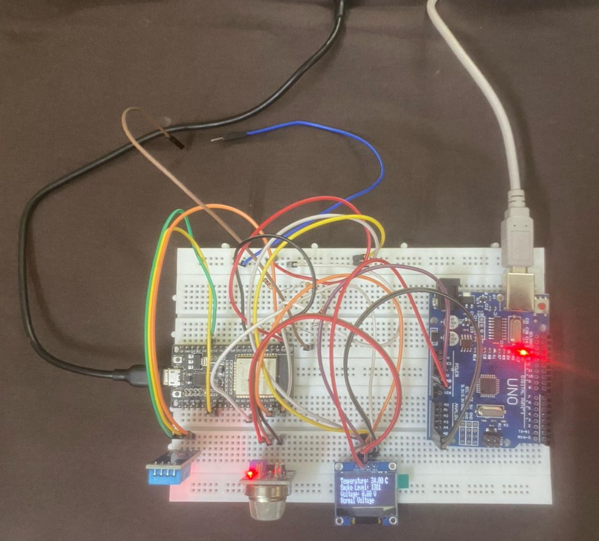
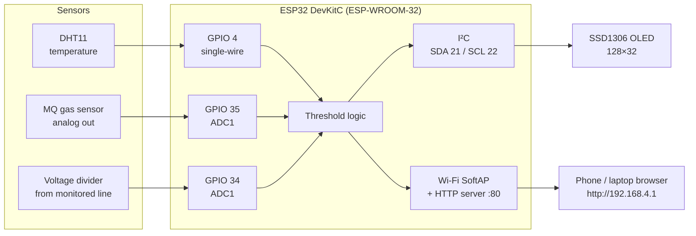
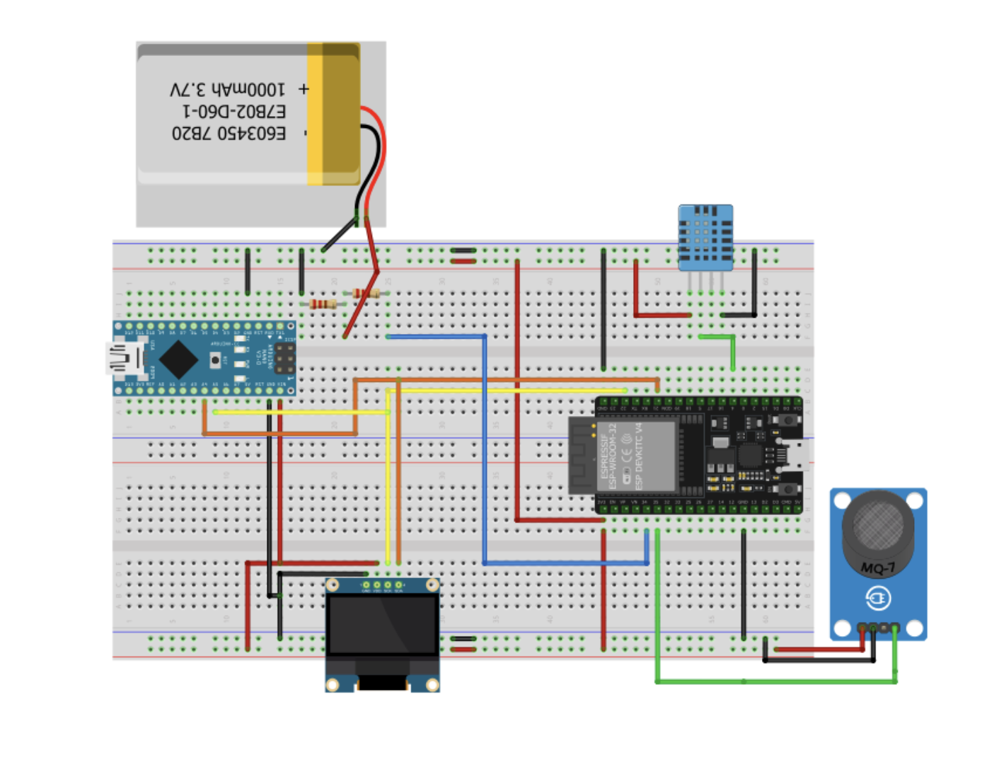
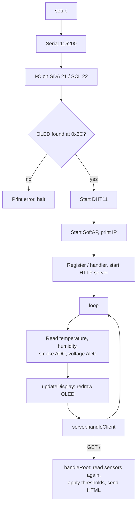
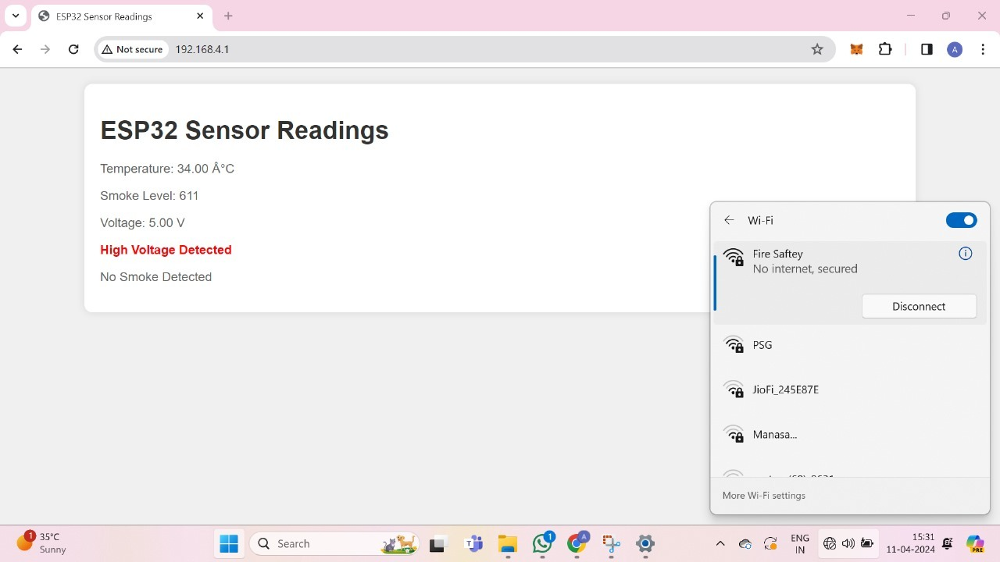
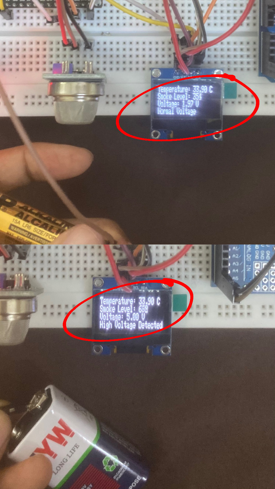
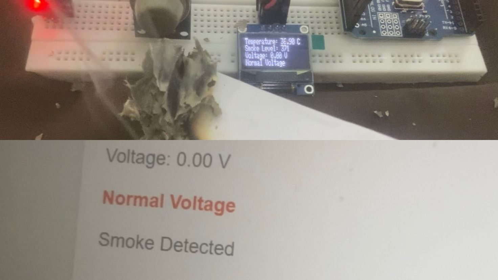

<div align="center">

# Industrial Safety Monitoring System

**Fire and electrical hazard monitoring on a single ESP32**

An ESP32 node that reads temperature, smoke/gas level and line voltage, shows them on an OLED, and serves a live dashboard over its own Wi-Fi network. No router, cloud or app needed.


[Demo video](https://drive.google.com/file/d/1eCu-SYhrc498uGOFyV1ir-LN3STYyLBa/view?usp=sharing) · [Quick start](#quick-start) · [Project report](report.pdf)

</div>



> **Academic prototype. Not a certified safety device.** It must not replace certified fire
> detection, gas detection or electrical protection equipment. See [Limitations](#limitations).

## Contents

- [Problem](#problem)
- [What it does](#what-it-does)
- [System architecture](#system-architecture)
- [Hardware](#hardware)
- [Firmware](#firmware)
- [Quick start](#quick-start)
- [Using the system](#using-the-system)
- [Test results](#test-results)
- [Calibration](#calibration)
- [Limitations](#limitations)
- [Roadmap](#roadmap)
- [Repository layout](#repository-layout)
- [Team](#team)

## Problem

Industrial sites carry fire and electrical risks. Manual inspection rounds and standalone
sensors leave gaps: a reading is only useful if someone sees it in time. The aim of this project
is a low-cost embedded node that monitors temperature, smoke and voltage all the time, flags
readings that cross a threshold, and makes them visible both at the device and on any nearby
phone or laptop.

## What it does

| Function | How |
| --- | --- |
| **Temperature** | DHT11 on GPIO 4, read in degrees Celsius. Humidity is read but not shown. |
| **Smoke / combustible gas** | MQ-series gas sensor analog output on GPIO 35 (12-bit ADC). Alarm above raw count **1550**. |
| **Voltage level** | Resistor divider into GPIO 34 (12-bit ADC). Alarm above **3.0 V** as computed by the firmware. |
| **Local display** | 128×32 SSD1306 OLED on I²C (SDA 21, SCL 22, address `0x3C`). Readings and alarm status. |
| **Remote dashboard** | ESP32 runs as a Wi-Fi access point and serves an HTML page at `http://192.168.4.1/` that refreshes every 2 seconds. |

Alarm states shown on both the OLED and the web page:

| Condition | Rule in firmware | Message |
| --- | --- | --- |
| Smoke | `analogRead(35) > 1550` | `Smoke Detected` / `No Smoke Detected` |
| Over-voltage | `analogRead(34) × 5.0 / 4095 > 3.0` | `High Voltage Detected` / `Normal Voltage` |

## System architecture



Everything runs on the ESP32. There is no external server, database or internet connection.
The two analog inputs use ADC1 pins (GPIO 34 and 35), which stay usable while Wi-Fi is on
(ADC2 pins do not).

## Hardware

### Bill of materials

| Qty | Part | Notes |
| --- | --- | --- |
| 1 | ESP32 DevKitC (ESP-WROOM-32) | Main controller, Wi-Fi |
| 1 | DHT11 temperature and humidity sensor | Module with pull-up, or add 10 kΩ on DATA |
| 1 | MQ-series gas sensor module | MQ-7 in the schematic. Analog output (AO) used |
| 1 | SSD1306 OLED, I²C, 0.91" 128×32 | Address `0x3C` |
| 2 | Resistors for the voltage divider | Scales the monitored voltage into the ADC range |
| 1 | 3.7 V Li-ion cell, 1000 mAh | Monitored source in the schematic |
| 1 | Arduino board (Nano in the schematic, Uno in the photos) | Appears to be used only as a 5 V supply rail. No firmware for it is in this repo |
| 1 | Breadboard, jumper wires, USB cable | |

### Pin map

| ESP32 pin | Connects to | Direction | Bus |
| --- | --- | --- | --- |
| GPIO 4 | DHT11 DATA | Input | Single-wire |
| GPIO 35 | MQ sensor AO | Input (ADC1_CH7) | Analog |
| GPIO 34 | Voltage divider midpoint | Input (ADC1_CH6) | Analog |
| GPIO 21 | OLED SDA | Bidirectional | I²C |
| GPIO 22 | OLED SCL | Output | I²C |
| 3V3 / 5V | Sensor VCC | Power | |
| GND | Common ground for all modules | Power | |

### Schematic



> **Electrical cautions**
> - ESP32 GPIOs tolerate **3.3 V maximum**. MQ modules powered at 5 V can drive AO close to 5 V.
>   Put a divider on AO, or confirm it stays below 3.3 V, before connecting it to GPIO 35.
> - Choose the voltage divider so the highest voltage you monitor maps to under 3.3 V at GPIO 34.
> - Never connect mains voltage to this circuit. Use an isolated, rated voltage transducer.
> - All grounds (ESP32, Arduino supply, sensors, monitored source) must be common.

## Firmware

Source: [industry.ino.txt](industry.ino.txt) (Arduino sketch, about 150 lines of C++).

### Program flow



### Functions

| Function | Role |
| --- | --- |
| `setup()` | Starts serial, I²C, OLED, DHT11, the access point and the HTTP server. Halts if the OLED does not respond. |
| `loop()` | Reads all sensors into globals, redraws the OLED, serves any pending HTTP request. Runs without delay. |
| `handleRoot()` | Takes fresh readings, applies thresholds, builds the dashboard HTML (inline CSS, 2-second meta refresh), returns `200 text/html`. |
| `updateDisplay()` | Clears the OLED and prints temperature, smoke level, voltage, then the voltage and smoke status lines. |

### Configuration

All settings are compile-time constants at the top of the sketch.

| Constant | Default | Meaning |
| --- | --- | --- |
| `DHT_PIN` | `4` | DHT11 data pin |
| `SMOKE_SENSOR_PIN` | `35` | MQ sensor analog pin |
| `VOLTAGE_SENSOR_PIN` | `34` | Voltage divider pin |
| `OLED_SDA` / `OLED_SCL` | `21` / `22` | I²C pins |
| `OLED_WIDTH` / `OLED_HEIGHT` | `128` / `32` | Display size |
| `ssid` | `"Battery Magmnt"` | Access point name. See note below |
| `password` | `"password"` | Access point password (WPA2, 8+ characters) |
| Smoke threshold | `1550` (raw ADC count) | Hard-coded in `handleRoot()` and `updateDisplay()` |
| Voltage threshold | `3.0` V | Hard-coded in `handleRoot()` and `updateDisplay()` |

> **SSID note.** The sketch in this repo sets the access point name to `Battery Magmnt`. The demo
> and screenshots used `Fire Saftey`. Connect to whichever name the board advertises, or change
> `ssid` before flashing. Change the password before any deployment outside a lab.

### Dependencies

| Library | Source | Used for |
| --- | --- | --- |
| ESP32 Arduino core (`WiFi.h`, `WebServer.h`, `Wire.h`) | Espressif, via Boards Manager | Access point, HTTP server, I²C |
| DHT sensor library | Adafruit | DHT11 driver |
| Adafruit Unified Sensor | Adafruit | Required by the DHT library |
| Adafruit SSD1306 | Adafruit | OLED driver |
| Adafruit GFX Library | Adafruit | Required by SSD1306 |

## Quick start

### 1. Get the code

```bash
git clone https://github.com/SwethaatGH/industrialsafetyembedded.git
cd industrialsafetyembedded
mkdir -p industry && cp industry.ino.txt industry/industry.ino
```

The Arduino toolchain needs the sketch in a folder of the same name with a `.ino` extension.

### 2a. Build and flash with Arduino IDE

1. Install Arduino IDE 2.x.
2. **File → Preferences → Additional boards manager URLs:**
   `https://espressif.github.io/arduino-esp32/package_esp32_index.json`
3. **Tools → Board → Boards Manager:** install **esp32 by Espressif Systems**.
4. **Tools → Manage Libraries:** install *DHT sensor library*, *Adafruit Unified Sensor*,
   *Adafruit SSD1306* and *Adafruit GFX Library*.
5. Open `industry/industry.ino`, select **ESP32 Dev Module** and the board's serial port.
6. Click **Upload**. If the upload stalls at `Connecting...`, hold the board's **BOOT** button.

### 2b. Build and flash with arduino-cli

```bash
arduino-cli config add board_manager.additional_urls \
  https://espressif.github.io/arduino-esp32/package_esp32_index.json
arduino-cli core update-index
arduino-cli core install esp32:esp32
arduino-cli lib install "DHT sensor library" "Adafruit Unified Sensor" \
  "Adafruit SSD1306" "Adafruit GFX Library"

arduino-cli compile --fqbn esp32:esp32:esp32 industry
arduino-cli upload  --fqbn esp32:esp32:esp32 -p /dev/ttyUSB0 industry   # use your port
```

### 3. Check it booted

```bash
arduino-cli monitor -p /dev/ttyUSB0 -c baudrate=115200
```

Expected output:

```
AP IP address: 192.168.4.1
```

If you see `SSD1306 allocation failed`, the OLED was not found on I²C: check SDA/SCL wiring,
power, and that the module's address is `0x3C`.

## Using the system

1. Power the board. The OLED starts showing readings within a second or two.
2. On a phone or laptop, join the Wi-Fi network advertised by the board
   (`Battery Magmnt` in the current sketch) with password `password`.
   The OS will report "No internet". That is expected.
3. Open **<http://192.168.4.1>**. The page refreshes every 2 seconds.



The dashboard shows temperature, smoke level (raw ADC count), voltage, and the two alarm
lines. Several clients can view the page at once. Each request triggers a fresh sensor read.

## Test results

Bench tests recorded in the [project report](report.pdf), April 2024.

| Test | Stimulus | Observed | Result |
| --- | --- | --- | --- |
| Idle baseline | None | 34.00 °C, smoke 1381, 0.00 V, `Normal Voltage` | Readings live on OLED |
| Low voltage | 1.5 V AA cell on the voltage input | 1.97 V, `Normal Voltage` | Below threshold, no alarm |
| High voltage | 9 V battery on the voltage input | 5.00 V, `High Voltage Detected` (OLED and web) | Alarm raised |
| Smoke | Burning paper next to the MQ sensor | Web page: `Smoke Detected` | Alarm raised |
| Remote view | Laptop joined the AP | Dashboard loaded at `192.168.4.1` | Working |





The 9 V reading of **5.00 V** is the top of the scale (ADC count 4095 × 5.0 / 4095): the input
saturated, so the true value was not measured. See [Limitations](#limitations).

## Calibration

The thresholds are bench values. Before relying on them:

- **Smoke.** MQ sensors need a burn-in period (often 24–48 h for a new sensor) and a few minutes
  of warm-up at each power-on. Log raw counts in clean air at the install site, then set the
  threshold well above that baseline. Observed idle counts ranged from about 350 to 1400
  depending on warm-up, so a fixed 1550 is close to the noise.
- **Voltage.** The ESP32 ADC full scale is about 3.1–3.3 V at default attenuation, but the
  firmware scales counts with 5.0 / 4095. The displayed value is therefore neither the pin
  voltage nor the source voltage. To show real volts:

  ```cpp
  // R1 = top resistor (to source), R2 = bottom resistor (to GND)
  const float DIVIDER = (R1 + R2) / R2;
  float pin_mv = analogReadMilliVolts(VOLTAGE_SENSOR_PIN);   // factory-calibrated
  float source_v = pin_mv / 1000.0 * DIVIDER;
  ```

  Then set the threshold in source volts.
- **Temperature.** DHT11 is ±2 °C. Check against a reference thermometer.

## Limitations

Known issues in the current firmware, with the fix for each.

| Issue | Effect | Fix |
| --- | --- | --- |
| OLED is 128×32 but `updateDisplay()` prints 5 lines of 8 px | Only 4 lines fit. The `Smoke Detected` line never appears on the OLED (visible in the test photos) | Combine status lines, or use a 128×64 panel and set `OLED_HEIGHT 64` |
| Voltage scaled by 5.0 / 4095 | Displayed volts are wrong and saturate at 5.00 V | Use `analogReadMilliVolts()` and the divider ratio ([Calibration](#calibration)) |
| DHT11 read on every `loop()` pass with no delay, and again per HTTP request | DHT11 allows about 1 read per second. Extra reads return `NaN`, shown as `nan` | Read sensors on a 1–2 s timer (`millis()`), cache values, serve the cache |
| No `NaN` check on DHT reads | A failed read is shown and compared as-is | Check `isnan()` and keep the last good value |
| Web page has no charset declaration | `°C` renders as `°C` (visible in the screenshot) | Add `<meta charset='utf-8'>` or send `text/html; charset=utf-8` |
| Thresholds and credentials hard-coded and duplicated | Changing a threshold means editing two functions and reflashing | Move to named constants; later, store in NVS and expose a settings page |
| Single threshold, no hysteresis or debounce | Alarm flickers around the threshold | Require N consecutive samples, and separate set/clear levels |
| Alarm is visual only | No one is alerted if nobody is looking | Add a buzzer/relay output and push alerts (MQTT, HTTP webhook) |
| Default password `password`, plain HTTP | Anyone nearby can join and view | Unique password per unit, WPA2 at minimum, station mode on a managed network |
| No logging | Readings are lost when the page closes | Ring buffer in RAM/flash, or publish to a time-series store |
| No watchdog or sensor-fault detection | A hung sensor or disconnected wire is not reported | Enable task watchdog, flag out-of-range or stuck readings |
| MQ sensor is cross-sensitive | Responds to several gases and to humidity, not to smoke alone | Treat as an early-warning input only. Pair with a certified detector |

## Roadmap

- [ ] Fix the OLED line overflow and the web charset
- [ ] Non-blocking sampling loop with cached readings
- [ ] Calibrated voltage measurement via `analogReadMilliVolts()`
- [ ] Hysteresis and debounce on both alarms
- [ ] Buzzer and relay output for local alarm and load cut-off
- [ ] JSON endpoint (`/api/readings`) so the page can update without a full reload
- [ ] MQTT publishing and station mode for plant networks
- [ ] Thresholds and credentials stored in NVS, editable from a settings page
- [ ] Event log with timestamps

## Repository layout

```
.
├── README.md            This file
├── industry.ino.txt     ESP32 firmware (Arduino sketch; rename to .ino to build)
├── schematicdia.png     Breadboard wiring diagram
├── report.pdf           Project report: problem statement, schematic, code, test photos
└── docs/
    └── images/          Photos and screenshots from the report, used in this README
```

## Team

| Name |
| --- |
| Akshayaa M |
| Prathibha G |
| Sreenithi R |
| Swetha M |
| Thirisha S |

No license file is included. All rights are reserved by the authors unless a license is added.
